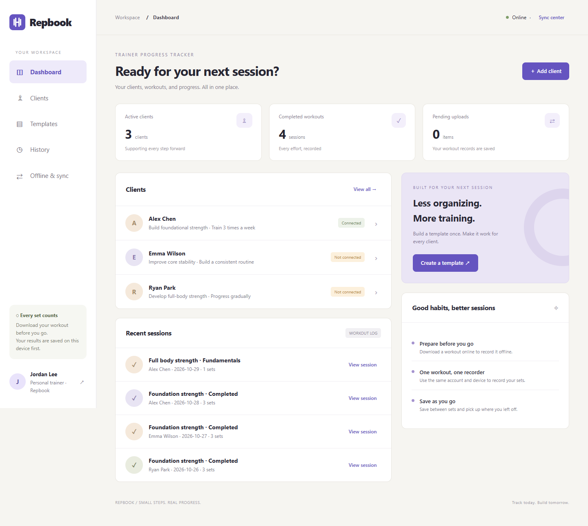

# Trainer Progress Tracker — Repbook MVP


**Status: working local MVP. Public HTTPS deployment and physical iPhone/Android acceptance testing are still outstanding. Uploading this repository to GitHub does not deploy the application.**



## Scope and implementation

| Plan feature | Implemented behavior |
| --- | --- |
| F1 — Accounts | Trainer/client registration, login/logout, password hashing, session cookies and CSRF protection |
| F2 — Profiles and connections | Trainer-owned profiles, in-app invitations, accept/decline, one trainer per linked client and server-side permissions |
| F3 — Planning | Reusable templates, exercise ordering, custom plans and assignments; later template edits do not change assigned plans |
| F4 — Recording | Coached or independent sessions, actual weight/reps per set, blank trainer sessions, additional exercises and past-workout entry |
| F5 — Corrections | Original recorder can correct completed results online using the original recording device |
| F6 — Body weight | Trainer entry/correction, client read access, one measurement per client/date |
| F7 — History | Authorized users can review completed sessions and their set results |
| F10 — Offline and sync | Prepared workouts and results persist locally; public app assets are cached; foreground uploads retry with duplicate prevention |
| F8 / F9 | Progress comparisons and history filters are deferred beyond the MVP, as specified in the plan |

Weights use **pounds (lb)**. Date validation uses **America/New_York**. Registration creates a real account in this application's database; demo accounts are optional sample accounts.

## Technology and architecture

- HTML, CSS and JavaScript frontend with responsive trainer/client views.
- Python Flask backend, Flask-WTF CSRF protection and SQLite storage.
- IndexedDB for downloaded sessions, local revisions and frozen pending uploads.
- Service Worker for public app-shell caching; private API responses are not cached.
- Unique operation IDs, request hashes and version checks for synchronization.
- One recorder/device per prepared session; IndexedDB tab leases help prevent concurrent editing.

**Differences from the planning draft:** the initial backend is grouped in `app.py`, and the UI is grouped in `static/app.js`, rather than the separate feature files proposed in the plan. Validated JSON snapshot columns store exercises and set results instead of separate child tables. Plan isolation, permissions and synchronization constraints remain enforced. The UI uses authorized list endpoints for plans/templates rather than separate GET-by-ID endpoints.

## Quick start

Requires **Python 3.10+**. `vendor/` contains local runtime dependencies and their license metadata, but not a Python interpreter.

1. Clone the repository or download and extract its ZIP.
2. On Windows, double-click `start.bat`. Or run from the project directory:

   ```sh
   python run.py --demo
   ```

3. Keep the terminal open and visit **http://127.0.0.1:5055**.
4. Use a demo account or select **New here? Create an account**.

Run `python run.py` to start without initializing demo data. Repeated demo initialization does not reset existing accounts. Closing the terminal stops the backend, even if the browser can still display a cached page.

### Standard development environment

```sh
python -m venv .venv
```

Activate on Windows with `.venv\Scripts\activate`, or on macOS/Linux with `source .venv/bin/activate`. Then:

```sh
python -m pip install -r requirements.txt
python seed_demo.py
python app.py
```

### Demo accounts

| Role | Email | Password |
| --- | --- | --- |
| Trainer | trainer@repbook.demo | Demo2026! |
| Client | client@repbook.demo | Demo2026! |

Sample profiles and measurements are fictional. Alex Chen is linked to the trainer; Emma and Ryan are unlinked profiles. Seeded historical sessions belong to a fixed seed recorder/device and are view-only in a new browser. Prepare a new workout to try recording and corrections.

The passwords above are intentionally public demo credentials. Do not use these accounts for real client records on an internet-facing deployment.

## Data and offline behavior

The local database is `instance/tracker.sqlite3`. Runtime data and session secrets are excluded from Git. Synced records survive application restarts; unsynced results belong to the original browser and origin.

- Prepare a workout online before recording it offline.
- Use the same account and browser/device that prepared the session to edit it.
- Select **Save progress** before closing. Saving is confirmed only after the IndexedDB transaction completes.
- A crashed/refreshed tab can retain its editing lease for about 20 seconds; the app retries automatically.
- Network/authentication failures retain pending uploads. Sign in to the same account to resume.
- Logout is blocked while results are pending. Successful logout clears private browser data.
- Changing browsers or switching between `localhost` and `127.0.0.1` does not move offline data or device reservations.
- Sync runs while the app is open, on reconnection, periodically and through **Sync now**; background uploads while closed are not guaranteed.

## Demonstration workflow

1. Trainer: open **Clients → Alex Chen → Assign workout** and choose a template or custom plan.
2. Choose the recorder: trainer for a coached session, or linked client for independent training. Sign in as that account before downloading.
3. Select **Download & start**, add a set, enter actual weight/reps and select **Save progress**.
4. Simulate offline mode in browser developer tools. Add another set and save.
5. Refresh, open **Offline & sync → Resume workout**, and confirm the saved results are available.
6. Select **Complete workout**, reconnect and select **Sync now**.
7. After synchronization, sign in as the other linked role and review the session in **History**.

## Planned team responsibilities

These roles come from the Project Plan. They describe **planned ownership**, not claims that each member has already implemented or reviewed the current code.

| Slice | Planned owner | Responsibilities |
| --- | --- | --- |
| 1 — Accounts and profiles | Giorgi Nebieridze | Authentication, roles, profiles, invitations, permissions and project setup |
| 2 — Workout planning | Shi Wei Wu Wu | Templates, exercise ordering, individual plans, assignments and offline preparation support |
| 3 — Recording and corrections | Salman Doria | Sessions, blank/past workouts, corrections, recovery and sync-test support |
| 4 — History and offline | Yusuf Doria | Measurements, history, local storage, Service Worker, retries and persistent HTTPS deployment |

All members share integration, code review, testing and demo preparation. Work in small task branches, link pull requests to Issues, and record actual validation before closing tasks.

## Milestones from the plan

These are **original target dates**, not completion claims.

| Milestone | Target window | Acceptance work still needed |
| --- | --- | --- |
| M1 — Setup and offline prototype | Oct 27–31, 2026 | Each teammate runs the app; verify phone offline reopening |
| M2 — Accounts and connections | Oct 31–Nov 3, 2026 | Team acceptance of registration, invitations and permission isolation |
| M3 — Planning and recording | Nov 3–6, 2026 | Team acceptance of assignments, coached/independent recording and snapshot isolation |
| M4 — History, corrections and sync | Nov 5–8, 2026 | Phone checks for recovery, corrections and duplicate-free uploads |
| M5 — Deployment and demo | Nov 9–10, 2026 | HTTPS hosting, persistent storage, iPhone Safari/Android Chrome tests and rehearsal |

## Tests and verification

Run the included backend suite with bundled dependencies:

```sh
python verify.py
```

Or from an activated development environment:

```sh
python -m unittest discover -s tests -v
```

The 10 integration tests cover CSRF, role/private-data access, independent plan snapshots, upload idempotency and version conflicts, recorder/device restrictions, one session per plan, measurement/date validation, restart persistence and single-trainer connections.

Earlier local Chrome checks exercised offline recovery, completion/sync, shared history, forms and English layouts at desktop and 390px widths. See [TEST_RESULTS.md](TEST_RESULTS.md). The repository includes backend tests, but not a portable browser automation suite.

**Physical iPhone Safari and Android Chrome testing has not been completed.** Responsive screenshots and desktop offline checks are not final mobile acceptance.

## Files

| Path | Purpose |
| --- | --- |
| `app.py` | API, authorization, validation and SQLite transactions |
| `schema.sql` | Database tables and constraints |
| `seed_demo.py` | Optional sample-data initialization |
| `run.py`, `start.bat` | Local startup |
| `requirements.txt` | Development and hosting dependencies |
| `verify.py`, `tests/test_app.py` | Automated backend verification |
| `static/app.js` | Views, forms, recording and foreground sync |
| `static/storage.js` | IndexedDB persistence |
| `static/sw.js` | Public app-shell caching |
| `static/styles.css` | Responsive styling |
| `static/index.html`, `static/manifest.json`, `static/icon.svg` | Entry point and web app metadata |
| `vendor/` | Bundled dependencies and license metadata |
| `instance/` | Runtime data; created locally and not tracked |

## API overview

Routes share the `/api` prefix and return `{"data": ...}` or `{"error": {"code": ..., "message": ...}}`. GET `/api/context` returns the user and CSRF token; mutations require `X-CSRFToken`.

| Routes | Purpose |
| --- | --- |
| `/register`, `/login`, `/logout`, `/context` | Account access |
| `/clients`, `/clients/{id}` | Profiles and trainer edits |
| `/invitations`, `/invitations/{id}/respond` | Connection requests and decisions |
| `/templates`, `/templates/{id}` | Template list/create/update |
| `/plans` | Authorized plans and assignments |
| `/sessions`, `/sessions/prepare`, `/sessions/past`, `/sessions/{id}` | Session list, preparation, past entry, reading and updates |
| `/clients/{id}/history` | Completed sessions |
| `/clients/{id}/body-weights`, `/body-weights/{id}` | Measurements and corrections |

Session uploads include `operation_id`, `device_id`, `base_version`, `name`, `workout_date`, `status` and `exercises`. Identical repeated operations return the existing receipt. Reused IDs with different payloads, stale versions and device conflicts return 409. See the integration tests for executable examples.

## Deployment and limitations

This is currently a **local application**. `127.0.0.1:5055` refers to the computer running it, not a phone-accessible public URL. GitHub hosts the source, not the running Flask backend.

For the complete mobile workflow, use a Python-compatible host with HTTPS and persistent storage:

1. Install `requirements.txt`.
2. Point `TRACKER_DATA_DIR` at a persistent directory and configure a stable `SECRET_KEY`.
3. Set `COOKIE_SECURE=1` for HTTPS; leave it disabled for local HTTP testing.
4. Use a production WSGI server behind the host's HTTPS proxy, for example:

   ```sh
   waitress-serve --listen=127.0.0.1:5055 --call app:create_app
   ```

   Adjust the bind address and port to match the provider's requirements.

5. Verify phone login, offline preparation/reopening, synchronization and records surviving a restart. Use SQLite's backup API for database backups.

Email verification, password reset, an all-user administration screen, production login throttling, automated backup scheduling and automatic conflict merging are not implemented. Invitations are in-app only. Separate installations have separate databases unless deliberately migrated.

Change the Service Worker cache version when updating cached assets. Clearing browser storage can erase unsynced results. Public HTTPS deployment and phone testing remain required before final acceptance against the Project Plan.
